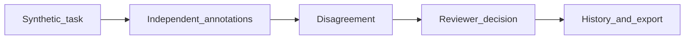

# Annotation Review Studio

Independent annotations, disagreement review and adjudicated export.

[](https://github.com/danielpdev/annotation-review-studio/actions/workflows/ci.yml)

**Role focus:** AI Data Tools / Full-stack Python. **Status:** working local portfolio implementation, with synthetic data.


## Demo


Excerpt from the recorded local UI demonstration, played faster. [Full recording](docs/demo.webm). [Screenshot](docs/screenshot.png). Rebuild with `./scripts/render_gif.sh` (FFmpeg required).

## The engineering decision

Two distinct annotators label an example. An independent reviewer resolves the label with a reason. Export includes only adjudicated examples; later review decisions append to history.



## Run locally

Requirements: Python 3.12, [uv](https://docs.astral.sh/uv/getting-started/installation/) and Make.

```bash
git clone https://github.com/danielpdev/annotation-review-studio.git
cd annotation-review-studio
make setup
make demo
make test
make eval
```

`make demo` uses an isolated temporary database where relevant, so it is safe to repeat. `make eval` writes a timestamped report to `reports/evaluation-fixture.json`. Fixture mode is deterministic and does not represent model inference. There is no recurring hosting or API subscription cost.

For the React interface (Node 22+ and pnpm 11.25.0):

```bash
make web-setup web-build
make serve
```

Open `http://127.0.0.1:8117`. The same server exposes `/docs`.

[Watch the recorded demo](docs/demo.webm) · [Reproduce the walkthrough](docs/DEMO.md)

## Verification and evidence

Independent reviewer enforcement, two-annotation prerequisite, immutable annotation labels, disagreement detection and revised adjudication history.

- [Evaluation report](reports/evaluation-fixture.json) — measured during an actual run; inspect the mode and dataset size.
- [Development and authorship](docs/DEVELOPMENT.md).
- [Romanian interview preparation](docs/INTERVIEW_RO.md).
- [Design notes](docs/DESIGN.md).
- [Demo walkthrough](docs/DEMO.md).

CI uses standard GitHub-hosted runners and deterministic tests without downloading LLM weights. The lockfiles record exact package versions. Local-model results, when present, live in `reports/evaluation-local.json`; hardware/model identities are in `reports/environment.json`.

## Limits and next iteration

Demo identities are text fields, not authenticated accounts. This is a tool for labeling work, not a claim of native Spanish or medical annotation expertise. The UI is not a blind annotation study interface.

Next: Add authenticated roles, blinded task assignment, sampling and inter-annotator agreement statistics.

The local demonstration does not include production authentication, secret management or operational service guarantees. Bind it to localhost and use synthetic data. These projects demonstrate engineering decisions; they do not claim real customers, paid production deployments or guaranteed interviews.

## Project ownership

Implemented with Codex assistance for Daniel Popa. The owner should review the code, run it, make an independent change and rehearse the tradeoffs before presenting it at interview. That human understanding check is pending and cannot be verified automatically. See [development notes](docs/DEVELOPMENT.md).

MIT for original source; dependencies/models retain their own licenses. See [third-party notices](THIRD_PARTY.md).

## Reproduce browser acceptance

```bash
make web-setup web-build
uv run --frozen --group browser playwright install chromium
uv run --frozen --group browser python scripts/ui_smoke.py
```

The script starts and stops its own local API using a temporary database. It checks a meaningful UI action and mobile overflow.
